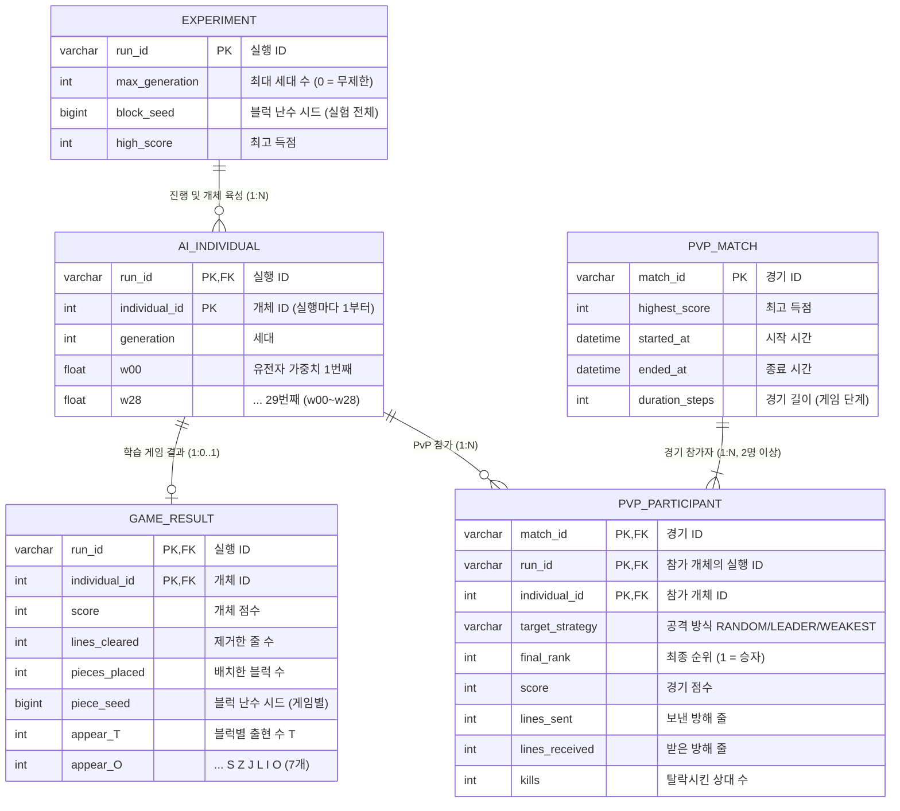

# TetrisAI

유전 알고리즘과 신경망을 이용하여 테트리스 플레이 전략을 학습하는 프로젝트입니다. AI는 블록을 배치할 수 있는 위치를 평가하고, 세대를 거치며 더 높은 게임 점수를 얻도록 진화합니다.

## 실행 환경 (Requirements)

이 프로젝트는 Processing(Java Mode) 으로 작성된 데스크톱 프로그램입니다. 테트리스 시뮬레이션과 CSV 생성에는 별도의 Python, MySQL 설치가 필요하지 않습니다. Python + MySQL은 추후 CSV 데이터를 취합·분석하는 DB 팀프로젝트에서 사용합니다.

| 항목 | 내용 |
|---|---|
| 실행 프로그램 | Processing IDE (Java Mode) |
| 최신 버전 | **동작 확인** (기존 문서에 기재된 테스트 버전: Processing 4.4.6) |
| 약 5년 전 사용한 버전 | **동작 확인** (정확한 버전 번호 미기록) |
| 그 밖의 Processing 버전 | **미검증** — 호환성을 보장하지 않음 |
| 운영체제 | 특정 운영체제의 호환성 전체를 검증한 것은 아님. 한글 글꼴은 OS별로 달라질 수 있음 |
| 필요한 프로젝트 파일 | 전체 `TetrisAI` 스케치 폴더 및 그 안의 `.pde`, `data/` 파일 |

> 동작 확인은 사용자가 실제 사용해 본 버전 기준입니다. 다른 Processing 버전에서의 실행 여부는 확인하지 않았습니다.

## 설치 및 실행 방법 (Getting Started)

**1. Processing 설치 및 Java Mode 확인**

Processing IDE를 설치하고 실행합니다. 상단 모드가 **Java**인지 확인하세요. 이 프로그램은 Python 스크립트가 아니라 Processing 스케치이므로, Python이나 VS Code의 일반적인 실행 버튼으로 `.pde` 파일을 실행하지 않습니다.

**2. 프로젝트 폴더 준비**

전달받은 압축파일을 해제한 후, 아래처럼 **`TetrisAI.pde`가 `TetrisAI` 폴더 바로 아래**에 있는지 확인합니다. `.pde` 파일 하나만 꺼내지 말고 프로젝트 폴더 전체를 유지하세요.

```text
TetrisAI/
├── TetrisAI.pde                 ← 실행할 메인 스케치
├── Population.pde
├── Tetris.pde
├── NeuraNet.pde
├── NetMatrix.pde
├── Founders.pde                 ← 시조 이름 관리 (CSV 확장 버전)
├── ...                         ← 기타 .pde 파일
└── data/
    └── founder_genomes_v1.csv  ← 공통 시조 유전자 (수정·삭제 금지)
```

**3. Processing에서 폴더 열기**

1. Processing IDE 메뉴에서 **File → Open... (파일 → 열기)** 를 선택합니다.
2. 압축 해제한 **`TetrisAI` 폴더**로 이동합니다.
3. 그 안의 **`TetrisAI.pde`를 선택하여 엽니다.** 이것이 프로젝트의 **메인 실행 파일**입니다.
4. 같은 폴더의 다른 `.pde` 파일은 스케치의 탭으로 함께 로드됩니다. `Population.pde`나 `Tetris.pde`를 따로 실행할 필요가 없습니다.
5. 좌측 상단의 **▶ Run (실행)** 버튼을 누릅니다.

**4. 실험 설정 창 (v2.1.0)**

실행하면 시조 유전자 검증 직후 **실험 설정 창**이 뜹니다. `취소`를 누르면 아무것도 만들지 않고 종료합니다.

| 항목 | 설명 |
|---|---|
| 실행자 이름 | `run_id` 앞부분 (영문/숫자). 비우면 `RUN`. 예: `DONGHYUN` → `DONGHYUN_20261030_141502_3F9A1C2B` |
| 블록 난수 시드 | 정수. **비우면 무작위로 정하고 CSV에 기록**하므로 나중에 같은 실험을 재현할 수 있습니다 |
| 최대 세대 수 | 이 세대까지 저장하면 실험을 끝냅니다. `0` = 무제한 (기존 방식) |
| 같은 블록 순서 | 체크하면 같은 세대의 200개체가 모두 같은 블록 순서로 플레이 (공정 비교). 해제하면 개체마다 다른 순서 (원본 방식, 기본값) |

- **같은 시드 + 같은 설정 = 완전히 같은 실험**: 블록 순서뿐 아니라 부모 선택·교차·돌연변이 난수도 이 시드에서 시작하므로, 세대별 점수·계보·유전자까지 똑같이 재현됩니다. (실행 속도 배수와는 무관)
- 창 없이 실행하려면 `TetrisAI.pde` 상단에서 `ASK_SETTINGS_ON_START = false`로 두고 `RUN_OWNER`, `DEFAULT_BLOCK_SEED`, `DEFAULT_MAX_GENERATIONS`, `DEFAULT_SHARED_PIECES` 기본값을 사용합니다.
- 최대 세대에 도달하면 마지막 세대 저장 → `experiments.csv`에 `COMPLETED` 기록 → 역대 최고 기록 JSON 저장 후 화면 하단에 완료 표시가 나옵니다. ESC로 종료하세요.

**팀원 간 데이터 비교를 위해 공통 시조 유전자 파일과 그 설정값은 변경하지 마세요.**

**5. 실행 상태 확인**

실행하면 게임 창이 열리고 Processing 콘솔에서 다음 메시지를 확인할 수 있습니다.

```text
[Font] 한글 표시 폰트: ...
[Founders] 고정 시조 유전자 로드: FOUNDERS_V1 (200 x 29), SHA-256 6fd10017…
[Founders] 검증 완료: 개체 200 / 시조 이름 200 / 가문 200 ...
[CSV] 실험 폴더 생성: .../exports/<run_id>
```

모든 개체가 한 세대의 플레이를 끝내면 다음과 같은 저장 메시지가 출력됩니다.

```text
[CSV] Gen N saved: 200 individuals, 5800 genes
```

CSV는 `TetrisAI/exports/<run_id>/`에서 확인할 수 있습니다. **각 팀원은 자신의 `<run_id>` 폴더 전체를 수집·전달**하면 됩니다. `in_progress/` 스냅샷은 최종 DB 적재 대상이 아닙니다.

**6. 실행 문제가 발생한다면**

- `TetrisAI.pde`가 아닌 다른 `.pde` 파일을 단독으로 열었는지 확인합니다.
- 프로젝트 폴더 이름이 `TetrisAI`인지, `TetrisAI.pde`와 다른 `.pde` 파일들이 같은 폴더에 있는지 확인합니다.
- `data/founder_genomes_v1.csv`가 존재하는지 확인합니다. 원본 파일을 엑셀 등으로 다시 저장하면 SHA-256 검증에 실패할 수 있습니다.
- Processing의 **Java Mode**로 실행 중인지 확인합니다.
- 오류가 발생하면 Processing 콘솔의 메시지를 확인합니다. 확인되지 않은 다른 버전에서는 호환성 문제가 생길 수 있습니다.

## 점수 계산 (Scoring)

| 플레이 결과 | 점수 |
|---|---:|
| 한 번에 1줄 제거 | 100점 |
| 한 번에 2줄 제거 | 200점 |
| 한 번에 3줄 제거 | 300점 |
| 한 번에 4줄 제거 (테트리스) | 800점 |
| 테트리스 연속 달성 (Back-to-back Tetris) | 1,200점 |

## 이동 위치 계산 (Calculating Moves)

새로운 블록이 등장하면 시스템은 해당 블록을 배치할 수 있는 모든 위치를 계산합니다. 각 위치에 블록을 배치했을 때의 게임 상태를 분석하고, 다음 특징값을 추출합니다.

### 신경망 입력 특징 (Features)

- **인접 열의 높이 차이 합계:** 서로 이웃한 열 사이의 높이 차이
- **구멍(Holes):** 블록으로 채울 수 없는 내부 빈 공간
- **최대 높이:** 쌓인 블록 구조의 최대 높이
- **최소 높이:** 쌓인 블록 구조의 최소 높이
- **제거한 줄 수:** 해당 배치로 제거되는 줄의 수

추출한 다섯 가지 특징값을 신경망에 입력하면 해당 배치의 평가 점수가 출력됩니다. 시스템은 가능한 모든 위치를 같은 방식으로 평가한 다음, 가장 높은 평가 점수를 받은 위치를 선택합니다. 이후 선택한 위치에 블록을 놓을 수 있도록 이동 및 회전 명령을 생성하여 실행합니다.

게임판은 10열이고 회전 상태는 최대 4가지이므로, 원본 프로그램 설명에서는 블록마다 **약 40가지 배치 후보**를 평가하는 것으로 설명합니다. 실제 유효한 배치 후보 수는 블록의 모양과 게임판 상태에 따라 달라질 수 있습니다.

## 학습 과정 (Training)

신경망의 가중치를 최적화하기 위해 **유전 알고리즘(Genetic Algorithm)** 을 사용합니다.

1. 각 세대마다 AI 개체 200개로 구성된 개체군을 생성합니다.
2. 모든 개체가 게임 오버가 될 때까지 테트리스를 플레이합니다.
3. 각 개체의 게임 점수를 바탕으로 우수한 개체를 선택합니다.
4. 선택한 두 부모 개체의 신경망 가중치 일부를 무작위로 조합하는 **교차(Crossover)** 를 수행합니다.
5. 교차로 생성한 신경망에 돌연변이율에 따른 **돌연변이(Mutation)** 를 적용합니다.
6. 새로운 개체군 200개를 구성하고 같은 과정을 반복합니다.

이 과정에서 여러 세대에 걸쳐 높은 점수를 얻는 방향으로 신경망이 진화합니다.

## 다음 블록 예측 (Next Piece Knowledge)

AI가 다음에 등장할 블록을 미리 알고 있다면, 현재 블록의 배치를 결정할 때 다음 블록의 최적 배치까지 고려할 수 있습니다.

현재 블록을 배치할 수 있는 각 후보 위치에 대해, 다음 블록을 배치할 수 있는 모든 위치를 다시 계산합니다. 그리고 다음 블록의 후보 배치들을 신경망으로 평가하여 얻은 최고 점수를 현재 블록의 후보 배치 점수에 더합니다.

즉, 현재 블록을 단독으로 평가하는 대신 **현재 블록과 다음 블록을 함께 고려한 결과**로 배치 위치를 선택합니다.

블록 하나당 약 40개 배치 후보가 있다고 가정하면, 다음 블록까지 고려할 때 평가 대상은 대략 **40² = 1,600가지**로 늘어납니다. 이 수치는 개략적인 계산량이며 실제 후보 수는 달라질 수 있습니다.

---

## 데이터베이스 팀프로젝트용 CSV 출력 규격

이 프로젝트는 DB조별과제 시나리오의 데이터 생성 프로그램으로 확장되었습니다.

테트리스 AI 자체는 Processing(Java 기반) 프로그램이며, 생성된 CSV 파일을 향후 **Python + MySQL**로 개발하는 별도의 데이터베이스 관리 프로그램에서 가져와 분석할 예정입니다. 테트리스 프로그램 자체에는 MySQL 연결이나 DB 관리 화면이 없습니다. 5개 테이블 구조·DDL·적재 방법은 아래 [DB 설계 (5개 테이블)](#db-설계-5개-테이블) 섹션을 참고하세요.

### 공통 시조 유전자 (팀원 간 데이터 통합)

모든 팀원이 **똑같은 200개 시조 유전자**로 시작하고, 그 이후의 진화(블록 순서, 점수, 부모 선택, 교차, 돌연변이, 가문 멸종, 우승 가문)는 각자 독립적으로 진행됩니다. 따라서 "동현 가문"은 어느 팀원의 데이터에서든 같은 초기 유전자를 뜻합니다.

- 시조 유전자 파일: `data/founder_genomes_v1.csv` (시조 200 × 가중치 29 = 5,800행, 배포본에 포함)

```csv
  founder_set_id,family_id,founder_name,gene_index,layer_index,row_index,col_index,weight
  FOUNDERS_V1,1,동현,0,0,0,0,-0.1683898
```

- `founder_set_id` = `FOUNDERS_V1`, 파일 SHA-256 = `6fd10017ed2731d85867685181e3925a4c48bd78c7426d4101c815958a4ff378`
- 실행할 때마다 이 파일을 읽어 1세대 신경망을 만듭니다. 시조 개체는 처음부터 이 유전자로 생성되므로 무작위 신경망으로 첫 수를 두는 일이 없습니다.
- 다음 경우에는 **시뮬레이션을 시작하지 않고** 화면과 콘솔에 원인을 표시합니다. 새 유전자를 임의로 만들지 않습니다.

  - 파일이 없음 / 헤더·행 수·시조 이름·유전자 위치가 맞지 않음 / 값이 수정됨

  - SHA-256이 코드의 `FOUNDER_GENOME_SHA256`과 다름

  - UTF-8 BOM 또는 CRLF 줄바꿈으로 바뀜 (Excel에서 열어 저장하면 이렇게 됩니다 → **이 파일은 Excel로 저장하지 마세요**)

- git으로 배포할 때 줄바꿈이 바뀌지 않도록 `.gitattributes`에서 이 파일을 binary로 지정했습니다. zip으로 전달해도 됩니다.
- **새 시조 집합을 의도적으로 만들 때만**: `TetrisAI.pde`에서 `FOUNDER_SET_ID`/`FOUNDER_GENOME_FILE`을 새 버전(예: `FOUNDERS_V2`, `founder_genomes_v2.csv`)으로 바꾸고 `GENERATE_FOUNDER_GENOMES = true`로 실행합니다. 기존 무작위 초기화 방식으로 파일을 한 번 만들고 SHA-256을 표시한 뒤 멈춥니다(같은 이름의 파일이 있으면 거부). 표시된 값을 `FOUNDER_GENOME_SHA256`에 넣고 플래그를 `false`로 되돌린 뒤 팀 전체에 다시 배포합니다.

### 여러 팀원의 데이터 합치기

- `run_id`는 실행마다 고유합니다: `<RUN_OWNER>_<시작 시각>_<UUID 앞 8자리>`. 여러 명이 같은 초에 실행해도 겹치지 않습니다.
- `individual_id`는 **실행마다 1부터** 다시 시작합니다. 개체는 반드시 `(run_id, individual_id)` 조합으로 식별하세요. 부모 관계(`parentage.csv`)도 같은 `run_id` 안에서만 연결됩니다.
- 서로 다른 실행의 세대를 하나의 계보로 이어 붙이지 마세요. 각 실행은 독립된 진화 실험입니다.
- 가문은 `experiments.founder_set_id`가 같은 실행끼리 `family_id`로 비교할 수 있습니다. 합치기 전에 모든 실행의 `founder_set_id`와 `founder_genome_sha256`이 같은지 확인하세요.
- 권장 키: `experiments(run_id)`, `families(run_id, family_id)` 또는 공통 `founder_families(founder_set_id, family_id)`, `individuals(run_id, individual_id)`, `parentage(run_id, child_individual_id, parent_role)`, `genes(run_id, individual_id, gene_index)`, `game_results(run_id, individual_id)`, `generations(run_id, generation)`

### 화면

- **단일 화면** (기본)

  - 왼쪽 열: 대표 개체 = **현재 살아 있는 개체 중 점수가 가장 높은 개체** (매 프레임 갱신, 동점이면 보던 개체 유지) — `Generation`, `Individual ID`, `Founder ID`, `Founder`, `Family`, `Current Score`, `Lines / Tetris`, 그리고 `Generation Best Score`, `All-Time High Score`, `Mutation Rate`

  - 오른쪽 열 `GENERATION BEST (incl. dead)`: 현재 세대에서 점수가 가장 높은 개체(사망 개체 포함)의 ID·시조·점수·생존 여부

  - 오른쪽 열 `ALL-TIME RECORD`: 모든 세대를 통틀어 최고 점수를 기록한 개체의 점수·세대·ID·시조, 그리고 `FINAL`(게임 종료 후 확정) / `IN PROGRESS`(아직 플레이 중) 상태

  - 오른쪽 열 `CSV EXPORT`: 출력 폴더, 마지막으로 저장된 세대, 저장 성공/오류 메시지

  - 세 개체(대표 / 세대 최고 / 역대 최고)는 서로 다른 개체일 수 있습니다.

- **전체 개체 화면** (SPACE)

  - 칸마다 `ID: <개체 고유 ID>`, `Founder: <시조 이름> (#<시조 ID>)`, `Score: <점수> ALIVE|DEAD` 를 표시합니다. 대표 개체(살아 있는 개체 중 최고 점수)는 노란색 + `BEST`, 사망 개체는 빨간색입니다.

  - 한 페이지에 최대 10×4 = 40개를 표시하고, 넘치면 ←/→ 키로 페이지를 넘깁니다. (200개 = 5페이지)

  - 기본은 기존처럼 살아 있는 개체만 표시하고(모두 사망하면 전체 표시), **A 키**로 사망 개체를 포함한 200개 전체 표시로 전환합니다.

### 단축키

| 키 | 동작 |
|---|---|
| `SPACE` | 단일 화면 ↔ 전체 개체 화면 전환 |
| `←` / `→` | (전체 개체 화면) 페이지 이동 |
| `A` | (전체 개체 화면) 살아 있는 개체만 ↔ 사망 포함 전체 |
| `S` | 역대 최고 기록을 JSON으로 저장 (`exports/<run_id>/best_ai/gen….json` + `data/best_ai.json`) |
| `E` | CSV 저장 상태를 콘솔에 출력하고, 저장에 실패한 완료 세대가 있으면 즉시 재시도 |
| `P` | 진행 중인 세대의 현재 상태를 **별도 스냅샷**으로 저장 (`exports/<run_id>/in_progress/`, 최종 기록 아님) |
| `+` / `-` | 시뮬레이션 속도 x1 ~ x64, 기본 x4 (프레임당 진행 단계 수. 결과는 속도와 무관하게 같음) |
| `ESC` | 완료됐지만 미저장인 세대가 있으면 저장 → 역대 최고 기록 JSON 저장 → `experiments.csv`에 `STOPPED` 기록 → 종료 (창 닫기 버튼도 `STOPPED` 기록) |

### 시조와 가문

최초 세대의 200개 AI 개체를 각각 **시조(Founder)** 로 취급하고, 사전에 정한 고유 이름을 부여합니다. 각 시조는 하나의 가문을 형성합니다.

- 시조 ID 1: 동현 → **동현 가문**
- 시조 ID 2: 지훈 → **지훈 가문**
- 시조 ID 3: 현우 → **현우 가문**
- …
- 시조 ID 200: 규리 → **규리 가문**

후손은 기존 프로그램의 가문 승계 규칙에 따라 대표 부모의 가문 ID(`species_id`)를 계승합니다. 그러나 실제 유전적 관계는 두 부모의 ID를 각각 저장하여 **가문 소속과 부모·자식 관계를 구별**합니다. 시조의 후손이 더 이상 남지 않더라도 가문 기록은 삭제하지 않습니다.

- 시조 이름 목록은 `Founders.pde`의 `FOUNDER_NAMES` 배열입니다. 순서가 가문 ID를 결정하므로 정렬하거나 바꾸지 마세요.
- 가문 ID = 시조 ID = `species_id` (1~200). 1세대 개체 ID도 1~200이므로 시조의 `individual_id`와 `family_id`는 같은 값입니다.
- **교차(CROSSOVER)**: 두 부모 중 점수가 높은 쪽의 가문을 계승하고, 동점이면 `PARENT_B`(두 번째로 선택된 부모)의 가문을 계승합니다. (원본 규칙 그대로)
- **우수 개체 복제(ELITE_CLONE)**: 매 세대 0번 자리에 이전 세대 최고 점수 개체가 복제됩니다. 복제 개체는 새 개체 ID를 받고, 원본의 가문을 계승하며, 원본 ID가 `CLONE_SOURCE`로 기록됩니다. 돌연변이는 적용되지 않습니다(원본 동작).

### CSV 출력 경로

각 독립적인 실험은 `run_id`(예: `DONGHYUN_20261030_141502_3F9A1C2B`)로 구분하고, 다음 경로에 8개 CSV 파일을 저장합니다. 같은 이름의 폴더가 이미 있으면 `_2`, `_3`… 을 붙여 기존 결과를 절대 덮어쓰지 않습니다.

```text
exports/
└── <run_id>/
    ├── experiments.csv
    ├── generations.csv
    ├── families.csv
    ├── individuals.csv
    ├── parentage.csv
    ├── genes.csv
    ├── game_results.csv
    ├── block_usage.csv         (v2.1.0 추가)
    ├── by_generation/          (v2.1.0) 세대별로 나눈 같은 데이터 — 원하는 세대만 불러올 때
    │   ├── gen_0001/
    │   │   ├── generations.csv     (그 세대 1행)
    │   │   ├── individuals.csv     (그 세대 200개체)
    │   │   ├── parentage.csv
    │   │   ├── genes.csv           (그 세대 200 × 29행)
    │   │   ├── game_results.csv
    │   │   └── block_usage.csv
    │   ├── gen_0002/
    │   └── ...
    ├── best_ai/                (S 키 / 종료 시 역대 최고 기록 JSON)
    │   └── gen0003_id000512_score41800_FINAL.json
    ├── in_progress/            (P 키를 눌렀을 때만 생성, DB 적재 대상 아님)
    │   └── gen_<N>_snapshot_<시각>.csv
    └── pvp/                    (TetrisPvP를 실행했을 때만 생성, 아래 "배틀로얄" 참고)
        ├── pvp_matches.csv
        └── pvp_participants.csv
```

- **전체 CSV**(폴더 바로 아래 8개)는 모든 세대가 한 파일에 이어져 있어 DB에 한 번에 적재하기 좋고, **`by_generation/gen_NNNN/`** 은 같은 내용을 세대별로 나눈 것이라 특정 세대만 열거나 불러오기 좋습니다. 두 쪽 내용은 같습니다(세대 폴더 파일에도 헤더가 있음).
- 세대 폴더는 전체 CSV 저장이 성공한 뒤에 이름이 확정됩니다(`gen_NNNN.tmp` → `gen_NNNN`). `.tmp` 폴더가 남아 있으면 저장되지 않은 세대이므로 무시하세요.
- 용량은 세대당 약 2배(약 580KB)가 됩니다.

### CSV 파일별 내용

#### 1. `experiments.csv` — 실험 설정 및 결과 요약

```csv
run_id,founder_set_id,founder_genome_sha256,program_version,started_at,population_size,mutation_rate,input_nodes,hidden_nodes,output_nodes,hidden_layers,block_seed,piece_seed_mode,max_generations,completed_generations,best_score,best_individual_id,best_generation,status,ended_at
```

실험 ID, 사용한 공통 시조 집합(`FOUNDERS_V1`)과 그 파일의 SHA-256, 프로그램 버전(`2.1.0`), 시작 시각, 개체군 크기, 돌연변이율 및 신경망 구조를 기록합니다. 실험마다 1행을 사용합니다.

v2.1.0에서 추가된 컬럼 — 이 파일만 **세대가 저장될 때마다 1행 전체를 다시 씁니다** (임시 파일에 쓴 뒤 교체하므로 중간에 꺼져도 깨지지 않음):

| 컬럼 | 내용 |
|---|---|
| `block_seed` | 실험 시드 (설정 창 입력값 또는 자동으로 정한 값) |
| `piece_seed_mode` | `PER_INDIVIDUAL`(개체마다 다른 블록 순서) / `SHARED_PER_GENERATION`(세대 전체가 같은 순서) |
| `max_generations` | 설정한 최대 세대 수 (`0` = 무제한) |
| `completed_generations` | 저장 완료된 세대 수 |
| `best_score`, `best_individual_id`, `best_generation` | 저장된 세대 중 최고 점수와 그 개체·세대 (아직 없으면 빈 칸) |
| `status` | `RUNNING` / `COMPLETED`(최대 세대 도달) / `STOPPED`(ESC·창 닫기로 중간 종료). 강제 종료(작업 관리자 등)되면 `RUNNING`으로 남습니다 |
| `ended_at` | 종료 시각 (실행 중이면 빈 칸) |

빈 칸은 MySQL에서 `NULLIF(@col, '')`로 NULL 처리해 적재하세요.

#### 2. `generations.csv` — 세대별 통계

```csv
run_id,generation,population_size,highest_score,average_score,completed_at
```

각 세대의 개체 수, 최고 점수, 평균 점수, 세대 종료 시각을 기록합니다. **완료된 세대마다 1행**을 사용하며, 최고·평균 점수는 해당 세대 개체들의 실제 최종 점수에서 계산합니다.

#### 3. `families.csv` — 시조 및 가문

```csv
run_id,family_id,founder_individual_id,founder_name,family_name
```

가문 ID, 시조 개체 ID, 시조 이름 및 가문 이름을 기록합니다. 기본 개체군 200개를 기준으로 실험마다 **200행**을 생성합니다. 가문 ID는 `species_id`에 대응합니다.

#### 4. `individuals.csv` — AI 개체

```csv
run_id,individual_id,generation,family_id,birth_type
```

개체의 고유 ID, 소속 세대, 가문 ID 및 탄생 방식을 저장합니다. `birth_type`은 다음 값 중 하나입니다.

- `FOUNDER`: 최초 세대 시조
- `CROSSOVER`: 부모 개체 두 개의 유전자를 교차해 생성된 자손
- `ELITE_CLONE`: 우수 개체를 복제하여 생성된 자손

개체 ID는 **같은 실험 안에서 중복되지 않도록** 관리하며, 복제된 자손에게도 새로운 개체 ID를 부여합니다.

#### 5. `parentage.csv` — 부모·자식 관계

```csv
run_id,child_individual_id,parent_individual_id,parent_role
```

자식 개체와 부모 개체의 관계를 기록합니다. `parent_role`은 `PARENT_A`, `PARENT_B`, `CLONE_SOURCE` 중 하나입니다.

- 교차로 탄생한 자손: 부모 관계 2행
- 우수 개체 복제로 탄생한 자손: 복제 출처 관계 1행
- 최초 세대 시조: 부모 관계 없음

두 부모가 우연히 같은 개체여도 부모 역할을 구별해 기록합니다. 이 파일을 이용해 특정 개체의 부모, 조상, 후손을 조회할 수 있습니다.

#### 6. `genes.csv` — 신경망 유전자 가중치

```csv
run_id,individual_id,gene_index,layer_index,row_index,col_index,weight
```

개체별 신경망 가중치를 기록합니다. 가중치가 속한 레이어·행·열 위치와 실제 가중치 값을 저장합니다.

원본 `NeuraNet.pde`의 기본 구조는 입력 5개, 은닉 4개, 출력 1개, 은닉층 1개이며, **편향(Bias)을 포함한 가중치는 총 29개**입니다. 입력→은닉층 가중치가 4 × (5 + 1) = 24개, 은닉층→출력 가중치가 1 × (4 + 1) = 5개입니다. 따라서 기본 설정에서는 개체별 **29행**을 출력합니다. 신경망 구조를 변경하면 그에 따라 행 수도 달라져야 합니다.

`gene_index`, `layer_index`, `row_index`, `col_index`는 0부터 시작하는 것으로 통일합니다.

#### 7. `game_results.csv` — 게임 플레이 결과

```csv
run_id,individual_id,generation,score,lines,tetris_count,total_back_to_back,single_clears,double_clears,triple_clears,pieces_placed
```

개체별 최종 점수, 제거한 줄 수, 테트리스 횟수, 연속 테트리스 횟수, 1·2·3줄 제거 횟수, 사용한 블록 수를 기록합니다.

**개체당 게임 1회**이며, 게임이 끝난 개체의 최종 결과를 1행으로 저장합니다. 모든 값은 `Tetris.pde`가 게임 중 실제로 집계한 값입니다. (`tetris_count` = `tetris` 필드, `total_back_to_back` = 연속 테트리스 누적 횟수)

#### 8. `block_usage.csv` — 블록 사용 기록 (v2.1.0)

```csv
run_id,individual_id,generation,piece_seed,pieces_placed,appear_T,appear_S,appear_Z,appear_J,appear_L,appear_I,appear_O,appear_total
```

개체 게임 1회당 1행. `piece_seed`는 그 게임의 블록 순서 시드로, 실험 시드(`experiments.block_seed`)와 세대·개체 순번에서 결정적으로 계산됩니다. `appear_*`는 블록 종류별로 **뽑힌 횟수**(마지막에 "다음 블록"으로 뽑혔지만 놓이지 못한 1개 포함)이므로 `appear_total = pieces_placed + 2`가 일반적입니다(현재 블록 + 다음 블록). 컬럼 순서는 `TetrisAI.pde`의 `tetrominos` 배열 순서(T, S, Z, J, L, I, O)와 같습니다.

`SHARED_PER_GENERATION` 모드에서는 같은 세대 개체들의 `piece_seed`가 모두 같습니다.

### 파일 간 관계

| 연결 키 | 용도 |
|---|---|
| `run_id` | 같은 실험에 속한 데이터 식별 (개체는 `(run_id, individual_id)`로 식별) |
| `family_id` | 개체가 속한 시조 가문 연결 |
| `individual_id` | 개체 정보·유전자·게임 결과 연결 |
| `child_individual_id`, `parent_individual_id` | 개체 간 부모·자식 관계 연결 |
| `generation` | 세대별 통계 및 개체 그룹 구분 |

실제 DB에서는 실험별 ID 중복을 방지하기 위해 필요에 따라 `run_id`를 포함한 **복합키**를 사용할 수 있습니다.

### 출력 시점 및 형식

- 최초 시조와 실험 설정(`experiments.csv`, `families.csv`)과 나머지 6개 파일의 헤더는 실험 시작 시 기록합니다.
- **세대교체 직전**(200개체가 모두 게임 오버된 프레임), 사망 개체를 포함한 200개체의 최종 점수와 유전자를 확정하여 6개 파일(`generations`, `individuals`, `parentage`, `genes`, `game_results`, `block_usage`)에 이어 쓰고, `experiments.csv`의 요약 컬럼을 갱신합니다. 파일 쓰기는 세대당 1회이며 매 프레임 쓰지 않습니다.
- **저장에 성공한 뒤에만** 다음 세대로 넘어갑니다. 저장 중 오류가 나면

  - 이번 세대에 이어 쓴 내용을 모든 파일에서 원래 길이로 되돌리고(부분 기록 방지),

  - 화면 `CSV EXPORT` 영역과 콘솔에 오류 원인을 표시하고,

  - 세대교체를 멈춘 채 2초마다(또는 `E` 키로 즉시) 재시도합니다.

- 완료되지 않은 세대의 중간 결과는 CSV 파일(전체·세대별 모두)에 기록하지 않습니다. `P` 키 스냅샷은 `in_progress/` 폴더에 `status`(ALIVE/DEAD)와 `is_final` 컬럼을 포함해 따로 저장됩니다.
- 이미 저장된 세대 번호는 다시 기록하지 않습니다.
- 프로그램을 종료해도 이미 저장된 세대는 그대로 남습니다. 종료 시점에 진행 중이던 세대는 기록되지 않습니다.
- 새로운 실행은 별도 `run_id` 디렉터리에 저장해 이전 결과를 덮어쓰지 않습니다.
- 형식

  - **UTF-8 (BOM 없음)**, **쉼표 구분**, **첫 줄 헤더**, 줄바꿈 **LF(`\n`)**

  - 쉼표·따옴표·개행이 들어간 문자열은 RFC 4180 방식으로 따옴표 처리 (현재 데이터에는 해당 값이 없음)

  - 정수는 정수 그대로, `average_score`는 소수점 4자리, `weight`와 `mutation_rate`는 지수 표기 없는 10진수(원래 float 값으로 정확히 복원 가능)

  - 시각은 `yyyy-MM-dd HH:mm:ss` (MySQL `DATETIME` 형식, 실행 PC의 로컬 시각)

- 저장 직전 참조 무결성을 검사합니다(개체 ID 중복, 세대 번호, 부모가 직전 세대의 실제 개체인지, 가문 승계 규칙, 유전자 개수 등). 문제가 있으면 콘솔에 `[CSV][검증 경고]`로 출력합니다.
- 용량 참고: 전체 CSV만 세대당 약 290KB(대부분 `genes.csv`)이고, `by_generation/` 사본까지 합치면 세대당 약 580KB입니다. 1,000세대면 약 580MB입니다.

### 데이터 읽기 예시

```python
import pandas as pd
genes = pd.read_csv("exports/DONGHYUN_20261030_141502_3F9A1C2B/genes.csv", encoding="utf-8")
```

```sql
LOAD DATA LOCAL INFILE 'exports/DONGHYUN_20261030_141502_3F9A1C2B/individuals.csv'
INTO TABLE individuals
CHARACTER SET utf8mb4
FIELDS TERMINATED BY ',' OPTIONALLY ENCLOSED BY '"'
LINES TERMINATED BY '\n'
IGNORE 1 LINES;
```

> Excel에서 열면 BOM이 없어 한글이 깨져 보일 수 있습니다. Excel에서는 **데이터 → 텍스트/CSV 가져오기**에서 UTF-8을 선택하세요. (파일 자체는 정상입니다)

### 역대 최고 기록 JSON (`S` / `ESC`)

v2.1.0부터 저장본은 **실행 폴더 안에 세대·개체·점수가 드러나는 이름**으로 저장됩니다: `exports/<run_id>/best_ai/gen0003_id000512_score41800_FINAL.json` (`FINAL` = 게임이 끝난 확정 점수, `INPROGRESS` = 아직 플레이 중일 때 저장). 이전의 `data/best_ai1.json`, `best_ai2.json`… 번호 파일은 더 만들지 않으며, `data/best_ai.json`은 BestAI·NeuralAnalyzer 호환을 위해 **가장 최근 저장본**으로 계속 덮어씁니다. 키 구조는 그대로이며 `block_seed`, `game_piece_seed`가 추가되었습니다.

- 이전에는 기록 개체를 `clone()`으로 보관해서 **새 개체 ID가 소비되고 점수·통계가 0으로 저장**되는 문제가 있었습니다. (기존 `best_ai.json`의 `"score": 0`, 1세대에 존재하지 않는 `"unique_id": 234` 가 이 문제의 결과입니다)
- 이제는 원본 개체의 값을 복사한 불변 스냅샷(`TetrisRecord.pde`)으로 보관하므로 개체 ID를 소비하지 않고, 원본 ID·시조·세대·점수·게임 통계·가중치가 그대로 저장됩니다.
- 추가된 키: `founder_id`, `founder_name`, `family_name`, `is_final`(게임 종료 후 확정된 값인지), `run_id`
- 역대 기록은 매 프레임 전체 200개체(사망 포함) 중 최고 점수로 갱신하고(기존: 1초마다, 화면에 표시된 대표 개체만 확인), 세대가 끝날 때 최종 점수로 다시 확정합니다.

### CSV 활용 예시

저장된 데이터를 Python 프로그램에서 MySQL로 가져오면 다음 분석을 수행할 수 있습니다.

- 역대 최고 점수를 기록한 개체와 소속 가문 조회
- 세대별 최고 점수 및 평균 점수 변화 분석
- 특정 개체의 부모·조상·후손 추적
- 가문별 생존 후손 수 및 멸문 여부 확인
- 우수 개체의 유전자 가중치 비교
- 실험 조건별 학습 성과 비교

---

## 배틀로얄 (TetrisPvP)

`TetrisPvP/` 폴더는 **유전 알고리즘과 별도로 실행하는 대결 프로그램**입니다. TetrisAI가 이미 저장한 `exports/<run_id>/`의 개체 유전자를 불러와 한 판에 모아 놓고 서로 공격하게 합니다. 학습 중인 컴퓨터에서 동시에 돌릴 필요 없이, 실험이 끝난 뒤(또는 중간에 저장된 세대만으로) 아무 컴퓨터에서나 실행하면 됩니다. TetrisAI 스케치를 열 때 이 하위 폴더는 무시되므로 서로 영향을 주지 않습니다.

**실행**: Processing에서 `TetrisPvP/TetrisPvP.pde`를 열고 ▶ Run. 실험 폴더를 다른 곳에 두었다면 `EXPORTS_DIR`에 경로를 지정하세요(기본값: `TetrisAI/exports`). 다른 팀원의 결과도 그 `<run_id>` 폴더를 `exports/` 안에 넣으면 선택할 수 있습니다.

**설정 창**

| 항목 | 설명 |
|---|---|
| 실험 | `exports/` 안의 `run_id` 폴더 (최근 순) |
| 세대 | `LAST`(마지막 저장 세대) 또는 세대 번호. **그 세대 개체 전원(200명)이 한 경기**에 참가합니다 |
| 블록 난수 시드 | 정수. 비우면 무작위 (기록됨) |
| 최대 단계 | 이 단계까지 끝나지 않으면 생존자 중 점수 1위가 우승 (`TIME_LIMIT`). 기본 200,000 |

실행 1번 = 경기 1번입니다. 세대 데이터는 `by_generation/gen_NNNN/`이 있으면 그 폴더에서, 없으면(2.0.0 실행 결과) 전체 CSV에서 해당 세대만 골라 읽습니다.

**최대 단계란?** 1단계 = 모든 참가자가 동시에 한 번 움직이는 게임 내부 시간 단위입니다(회전·좌우 이동 1번 또는 한 칸 낙하). 블록 하나를 놓는 데 대략 20~25단계가 들므로 200,000단계 ≈ 참가자당 블록 약 8,000~10,000개입니다. 방해 줄 때문에 보통 그 전에 끝나며, 무한히 버티는 경기를 막는 안전장치입니다. 기본 속도 x4(300fps)에서 200,000단계는 약 3분입니다(실제로는 참가자 계산량 때문에 더 느릴 수 있음).

**공격 방식**: 경기 시작 때 참가자마다 아래 3가지 중 하나가 **무작위로 배정**되고(경기 시드로 결정 → 재현 가능), 그 경기 동안 유지됩니다. 배정 결과는 `pvp_participants.target_strategy`에 기록되므로 어떤 방식이 유리한지 DB에서 비교할 수 있습니다. 화면에는 ID 옆에 `R`/`L`/`W`로 표시됩니다.

| 방식 | 공격 대상 |
|---|---|
| `RANDOM` | 살아 있는 상대 중 무작위 |
| `LEADER` | 현재 점수 1위 |
| `WEAKEST` | 가장 높이 쌓인 상대 (받을 예정인 방해 줄 포함) |

**규칙**

- 모든 참가자가 **같은 블록 순서**(경기 시드)로 동시에 플레이합니다. AI의 배치 판단은 학습 때(`Tetris.pde`)와 완전히 같습니다.
- 한 번에 k줄을 지우면 **k-1줄**을 공격 대상 1명에게 방해 줄로 보냅니다 (2줄→1, 3줄→2, 테트리스→3).
- 방해 줄은 **줄마다 무작위 한 칸이 비어 있는** 회색 줄로, 받은 쪽의 다음 블록이 놓이는 순간 아래에서 밀려 올라옵니다. 대기 중인 줄은 보드 왼쪽 빨간 막대로 표시됩니다.
- 방해 줄을 지우면 **높이만 줄어들 뿐 점수도 공격도 없습니다**. 점수는 일반 줄만으로 TetrisAI와 같은 규칙으로 계산합니다.
- 블록이 맨 윗줄에 닿거나 방해 줄에 밀려 판 위로 넘치면 탈락합니다. 마지막 1명이 남으면 우승(`LAST_SURVIVOR`), 마지막 생존자들이 같은 단계에 함께 탈락하면 그중 점수 1위가 우승(`SIMULTANEOUS_KO`)합니다.
- 순위: 생존자(점수순) → 늦게 탈락한 순 → 같은 단계 탈락이면 점수순 → 개체 ID순.
- 같은 실험·세대·시드면 경기 결과(공격 방식 배정 포함)가 똑같이 재현됩니다(속도 배수와 무관).

**단축키**: `+`/`-` 속도 x1~x256 (기본 x4), `SPACE` 일시정지, `←`/`→` 페이지, `A` 생존자만/전체, `ESC` 종료(진행 중인 경기는 저장되지 않음).

**출력** (`exports/<run_id>/pvp/`, 경기를 할 때마다 같은 두 파일에 이어 씀)

```csv
# pvp_matches.csv — 경기 1행
match_id,run_id,generation,program_version,block_seed,player_count,max_steps,started_at,ended_at,duration_steps,duration_ms,highest_score,highest_score_individual_id,winner_individual_id,end_reason

# pvp_participants.csv — 경기 × 참가자 1행
match_id,run_id,individual_id,generation,family_id,target_strategy,final_rank,score,lines,garbage_lines_cleared,lines_sent,lines_received,pieces_placed,tetris_count,kills,eliminated_step
```

- `match_id` = `PVP_<시각>_<UUID 8자리>` 형식으로 전역 고유. `generation` 컬럼으로 몇 세대 경기인지 구분합니다. `winner_individual_id`, `individual_id`는 `(run_id, individual_id)`로 `individuals`와 연결됩니다.
- `duration_steps`는 게임 내부 시간(재현 가능), `duration_ms`는 실제 경과 시간(속도 배수에 따라 달라짐).
- `kills` = 마지막으로 공격한 상대가 탈락한 횟수. `eliminated_step`은 생존자면 빈 칸.

---

## DB 설계 (5개 테이블)

### ER 다이어그램



### 테이블 정의

| 과제 항목 | 테이블 | PK | FK | 주요 속성 |
|---|---|---|---|---|
| [4] 실험 | `EXPERIMENT` | `run_id` | - | 최대 세대 수, 블럭 난수 시드(실험 전체), 최고 득점 |
| [1] AI 개체 | `AI_INDIVIDUAL` | `(run_id, individual_id)` | `run_id` → EXPERIMENT | 세대, 유전자 `w00`~`w28` |
| [3] 블럭 사용 기록 + [5] 학습 성능 | `GAME_RESULT` | `(run_id, individual_id)` | 같은 키 → AI_INDIVIDUAL | 개체 점수, 제거한 줄 수, 배치한 블럭 수, 블럭 난수 시드(게임별), 블럭별 출현 수 7개 |
| [2] PvP 경기 정보 | `PVP_MATCH` | `match_id` | - | 최고 득점, 시작·종료 시간, 경기 길이 |
| [2] PvP 경기 정보 (참가자) | `PVP_PARTICIPANT` | `(match_id, run_id, individual_id)` | `match_id` → PVP_MATCH, `(run_id, individual_id)` → AI_INDIVIDUAL | 공격 방식, 순위, 점수, 보낸·받은 줄, 탈락시킨 수 |

**관계**

1. **EXPERIMENT 1 : N AI_INDIVIDUAL**: 한 실험 안에서 여러 세대에 걸쳐 개체가 생성·진화합니다.
2. **AI_INDIVIDUAL 1 : 0..1 GAME_RESULT**: 개체 하나가 학습 게임을 1판 하고, 그 결과(점수·줄·블럭 사용)를 기록합니다. DB 제약상으로는 결과가 없는 개체도 허용되지만(0..1), 프로그램은 세대의 게임이 모두 끝난 뒤 개체와 결과를 **한 번에 저장하고 실패하면 전부 되돌리므로** 실제 데이터에서는 모든 개체에 결과가 있습니다.
3. **PVP_MATCH 1 : N PVP_PARTICIPANT, AI_INDIVIDUAL 1 : N PVP_PARTICIPANT**: 경기 하나에는 여러 개체가 참가하고, 한 개체는 여러 경기에 참가할 수 있습니다(N:M). 이 다대다 관계를 `PVP_PARTICIPANT`가 풀어 주며, 참가 개체마다 순위·공격 기록을 함께 저장합니다.

**설계 결정**

- **개체는 반드시 `(run_id, individual_id)` 복합키로 식별합니다.** `individual_id`는 실행마다 1부터 다시 시작하므로 ID만 PK로 쓰면 두 번째 실험을 넣을 때 PK가 중복됩니다. 개체를 참조하는 모든 FK도 같은 두 컬럼입니다.
- **학습 성능과 블럭 사용 기록을 `GAME_RESULT` 하나로 합쳤습니다.** 둘 다 같은 게임 1판의 결과라 키가 같은 1:1 관계였으므로, 나누면 JOIN만 늘고 얻는 것이 없습니다. 배치한 블럭 수가 두 곳에 중복되던 문제도 함께 없어집니다.
- **PvP 참가자는 경기와 분리된 `PVP_PARTICIPANT`에 둡니다.** 승자만 저장하면 패배한 개체의 참가 여부, 참가 횟수, 승률, 순위, 공격량을 알 수 없습니다.
- **승자 ID는 `final_rank = 1`인 참가자로 구합니다.** 경기 테이블에 `winner_id`를 따로 두면 참가자 테이블과 같은 사실을 두 번 저장하게 됩니다. 과제 요구 형태(경기 ID, 최고 득점, 시간, 승자 ID)로 보려면 아래 `PVP_MATCH_SUMMARY` 뷰를 씁니다. `UNIQUE (match_id, final_rank)`로 경기당 1위가 하나뿐임을 보장합니다.
- **참가자마다 자기 `run_id`를 가집니다.** 지금은 한 실행의 한 세대만 대결하지만, 여러 팀원·여러 실행의 개체를 섞어 대결시켜도 구조를 바꿀 필요가 없습니다. 그래서 경기 테이블에는 `run_id`를 두지 않습니다.
- **블럭 사용 기록은 시드가 아니라 게임 단위입니다.** 배치 횟수와 출현 수는 시드만으로 정해지지 않고 AI가 얼마나 버티는지에 따라 달라지므로 시드를 PK로 둘 수 없습니다. 같은 시드로 돌린 실험끼리는 `EXPERIMENT.block_seed`로 묶어 비교합니다. `EXPERIMENT.block_seed`(실험 전체 시드)와 `GAME_RESULT.piece_seed`(그 실험 시드에서 게임마다 계산된 시드)는 뜻이 다릅니다.
- **유전자(29개)와 블럭별 출현 수(7개)는 컬럼으로 나눴습니다(1정규형).** 한 칸에 이어 붙이면 SQL로 개별 값을 계산할 수 없습니다. 개수가 고정이라 컬럼으로 풀 수 있습니다.
- **일부러 저장한 계산값 2개:** `EXPERIMENT.high_score`(= 실험의 `MAX(GAME_RESULT.score)`), `PVP_MATCH.highest_score`(= 경기의 `MAX(PVP_PARTICIPANT.score)`). 목록 조회를 빠르게 하려고 둔 값이며, 프로그램이 기록한 값과 실제 최대값이 일치하는 것을 확인했습니다.
- 게임별 시드는 int 범위를 넘으므로 `BIGINT`, 경기 ID는 `PVP_20261112_082702_A6D96F10` 형식이므로 `VARCHAR`입니다.

### MySQL DDL

```sql
CREATE TABLE EXPERIMENT (
  run_id          VARCHAR(64) PRIMARY KEY,
  max_generation  INT         NOT NULL,
  block_seed      BIGINT      NOT NULL,
  high_score      INT         NULL          -- 저장된 세대가 없으면 NULL
);

CREATE TABLE AI_INDIVIDUAL (
  run_id         VARCHAR(64) NOT NULL,
  individual_id  INT         NOT NULL,
  generation     INT         NOT NULL,
  w00 FLOAT NOT NULL, w01 FLOAT NOT NULL, w02 FLOAT NOT NULL, w03 FLOAT NOT NULL, w04 FLOAT NOT NULL,
  w05 FLOAT NOT NULL, w06 FLOAT NOT NULL, w07 FLOAT NOT NULL, w08 FLOAT NOT NULL, w09 FLOAT NOT NULL,
  w10 FLOAT NOT NULL, w11 FLOAT NOT NULL, w12 FLOAT NOT NULL, w13 FLOAT NOT NULL, w14 FLOAT NOT NULL,
  w15 FLOAT NOT NULL, w16 FLOAT NOT NULL, w17 FLOAT NOT NULL, w18 FLOAT NOT NULL, w19 FLOAT NOT NULL,
  w20 FLOAT NOT NULL, w21 FLOAT NOT NULL, w22 FLOAT NOT NULL, w23 FLOAT NOT NULL, w24 FLOAT NOT NULL,
  w25 FLOAT NOT NULL, w26 FLOAT NOT NULL, w27 FLOAT NOT NULL, w28 FLOAT NOT NULL,
  PRIMARY KEY (run_id, individual_id),
  FOREIGN KEY (run_id) REFERENCES EXPERIMENT(run_id)
);

CREATE TABLE GAME_RESULT (
  run_id         VARCHAR(64) NOT NULL,
  individual_id  INT         NOT NULL,
  score          INT         NOT NULL,
  lines_cleared  INT         NOT NULL,
  pieces_placed  INT         NOT NULL,
  piece_seed     BIGINT      NOT NULL,
  appear_T INT NOT NULL, appear_S INT NOT NULL, appear_Z INT NOT NULL, appear_J INT NOT NULL,
  appear_L INT NOT NULL, appear_I INT NOT NULL, appear_O INT NOT NULL,
  PRIMARY KEY (run_id, individual_id),
  FOREIGN KEY (run_id, individual_id) REFERENCES AI_INDIVIDUAL(run_id, individual_id)
);

CREATE TABLE PVP_MATCH (
  match_id        VARCHAR(40) PRIMARY KEY,
  highest_score   INT         NOT NULL,
  started_at      DATETIME    NOT NULL,
  ended_at        DATETIME    NOT NULL,
  duration_steps  INT         NOT NULL
);

CREATE TABLE PVP_PARTICIPANT (
  match_id               VARCHAR(40) NOT NULL,
  run_id                 VARCHAR(64) NOT NULL,
  individual_id          INT         NOT NULL,
  target_strategy        VARCHAR(10) NOT NULL CHECK (target_strategy IN ('RANDOM', 'LEADER', 'WEAKEST')),
  final_rank             INT         NOT NULL,
  score                  INT         NOT NULL,
  lines_cleared          INT         NOT NULL,
  garbage_lines_cleared  INT         NOT NULL,
  lines_sent             INT         NOT NULL,
  lines_received         INT         NOT NULL,
  kills                  INT         NOT NULL,
  eliminated_step        INT         NULL,    -- 생존(우승)이면 NULL
  PRIMARY KEY (match_id, run_id, individual_id),
  UNIQUE (match_id, final_rank),
  FOREIGN KEY (match_id) REFERENCES PVP_MATCH(match_id),
  FOREIGN KEY (run_id, individual_id) REFERENCES AI_INDIVIDUAL(run_id, individual_id)
);

-- 과제 요구 형태: 경기 ID, 최고 득점, 시간, 승자 ID
CREATE VIEW PVP_MATCH_SUMMARY AS
SELECT m.match_id, m.highest_score, m.started_at, m.ended_at,
       p.run_id AS winner_run_id, p.individual_id AS winner_id
FROM PVP_MATCH m
JOIN PVP_PARTICIPANT p ON p.match_id = m.match_id AND p.final_rank = 1;
```

### CSV → 테이블 적재

| 테이블 | CSV (`exports/<run_id>/`) | 컬럼 대응 |
|---|---|---|
| `EXPERIMENT` | `experiments.csv` | `run_id`, `max_generations` → `max_generation`, `block_seed`, `best_score` → `high_score` (빈 칸 → NULL) |
| `AI_INDIVIDUAL` | `individuals.csv` + `genes.csv` | `run_id`, `individual_id`, `generation` + `genes.csv`의 `gene_index` 0~28을 `w00`~`w28`로 펼침 |
| `GAME_RESULT` | `game_results.csv` + `block_usage.csv` | 두 파일을 `(run_id, individual_id)`로 합침. `game_results`에서 `score`, `lines` → `lines_cleared`, `pieces_placed` / `block_usage`에서 `piece_seed`, `appear_T`~`appear_O` |
| `PVP_MATCH` | `pvp/pvp_matches.csv` | `match_id`, `highest_score`, `started_at`, `ended_at`, `duration_steps` |
| `PVP_PARTICIPANT` | `pvp/pvp_participants.csv` | `match_id`, `run_id`, `individual_id`, `target_strategy`, `final_rank`, `score`, `lines` → `lines_cleared`, `garbage_lines_cleared`, `lines_sent`, `lines_received`, `kills`, `eliminated_step` (빈 칸 → NULL) |

**적재 순서** (FK 때문에): `EXPERIMENT` → `AI_INDIVIDUAL` → `GAME_RESULT` → `PVP_MATCH` → `PVP_PARTICIPANT`

**변환이 필요한 두 테이블** (pandas):

```python
import pandas as pd

d = "exports/<run_id>/"
keys = ["run_id", "individual_id"]

# AI_INDIVIDUAL: genes.csv(개체당 29행)를 개체당 1행 29컬럼으로 펼침
ind = pd.read_csv(d + "individuals.csv")
genes = pd.read_csv(d + "genes.csv")
w = genes.pivot(index=keys, columns="gene_index", values="weight")
w.columns = [f"w{i:02d}" for i in w.columns]               # 0 → w00 ... 28 → w28
ai_individual = ind[keys + ["generation"]].merge(w.reset_index(), on=keys)

# GAME_RESULT: 같은 게임의 결과(game_results)와 블럭 기록(block_usage)을 합침
gr = pd.read_csv(d + "game_results.csv")[keys + ["score", "lines", "pieces_placed"]].rename(columns={"lines": "lines_cleared"})
bu = pd.read_csv(d + "block_usage.csv")[keys + ["piece_seed"] + [f"appear_{p}" for p in "TSZJLIO"]]
game_result = gr.merge(bu, on=keys, validate="one_to_one")
```

**주의**

- **v2.1.0 이상으로 실행한 결과만 이 구조에 넣을 수 있습니다.** v2.0.0 실행 폴더(`experiments.csv`에 `block_seed`가 없고 `block_usage.csv`가 없는 폴더)는 `EXPERIMENT.block_seed`와 `GAME_RESULT`의 블럭 컬럼을 채울 수 없습니다. `experiments.csv`의 `program_version`으로 구분하세요.
- 여러 팀원·여러 실행 폴더를 같은 테이블에 합쳐 넣어도 됩니다(복합키라 충돌 없음). PvP 결과는 각 실행 폴더의 `pvp/`에 있습니다.
- `status = RUNNING`인 실험은 강제 종료되었거나 아직 진행 중인 것입니다. 저장된 세대까지만 데이터가 있습니다.
- 특정 세대만 넣으려면 전체 CSV 대신 `by_generation/gen_NNNN/`의 파일을 쓰면 됩니다(형식 동일).
- 나머지 CSV(`generations`, `families`, `parentage`)와 각 CSV의 추가 컬럼(`family_id`, `birth_type` 등)은 5개 테이블에 없는 보조 데이터입니다. 가문·계보 분석이 필요해지면 테이블로 추가할 수 있습니다.

**검증 결과** (2026-11-12): 2세대까지 실행한 결과 + PvP 1경기와 실제 실행 1개(PvP 1경기 포함)를 위 구조(SQLite, 외래키 검사 ON)에 함께 적재했습니다.

| 항목 | 결과 |
|---|---|
| 적재 행 수 | EXPERIMENT 2 / AI_INDIVIDUAL 600 / GAME_RESULT 600 / PVP_MATCH 2 / PVP_PARTICIPANT 400 |
| PK 충돌, FK 위반 | 0건 |
| `game_results`와 `block_usage`의 배치 블럭 수 | 600개 모두 일치 (합쳐도 정보 손실 없음) |
| `high_score` = `MAX(score)`, `highest_score` = 참가자 최대 점수 | 모두 일치 |
| 경기당 1위 | 정확히 1명 (`PVP_MATCH_SUMMARY`로 승자 조회 확인) |

**예시 질의**

```sql
-- 세대별 평균 점수와 평균 배치 블럭 수
SELECT i.run_id, i.generation, AVG(g.score), AVG(g.pieces_placed)
FROM AI_INDIVIDUAL i
JOIN GAME_RESULT g ON g.run_id = i.run_id AND g.individual_id = i.individual_id
GROUP BY i.run_id, i.generation;

-- 개체별 PvP 참가 횟수와 승률
SELECT p.run_id, p.individual_id, COUNT(*) AS played,
       SUM(p.final_rank = 1) AS wins, AVG(p.final_rank = 1) AS win_rate, AVG(p.final_rank) AS avg_rank
FROM PVP_PARTICIPANT p
GROUP BY p.run_id, p.individual_id
ORDER BY wins DESC, avg_rank;

-- 공격 방식별 성적
SELECT target_strategy, COUNT(*) AS players, SUM(final_rank = 1) AS wins, AVG(final_rank) AS avg_rank, AVG(lines_sent)
FROM PVP_PARTICIPANT
GROUP BY target_strategy;

-- 학습(솔로) 점수가 높으면 PvP에서도 잘하는가
SELECT p.match_id, p.individual_id, g.score AS solo_score, p.final_rank, p.score AS pvp_score
FROM PVP_PARTICIPANT p
JOIN GAME_RESULT g ON g.run_id = p.run_id AND g.individual_id = p.individual_id
ORDER BY g.score DESC;

-- 같은 시드로 돌린 실험끼리 비교
SELECT block_seed, run_id, max_generation, high_score FROM EXPERIMENT ORDER BY block_seed, high_score DESC;
```

## 변경 이력

- **2.1.0**: 실험 설정 창(블록 난수 시드·최대 세대·같은 블록 순서), 시드 하나로 실험 전체 재현, `block_usage.csv` 추가, `experiments.csv`에 시드·최대 세대·최고 점수·상태 컬럼 추가, 속도 조절(`+`/`-`), 세대별 CSV 폴더(`by_generation/gen_NNNN/`), 최고 기록 JSON을 실행 폴더에 세대·개체·점수가 드러나는 이름으로 저장, 배틀로얄 프로그램 `TetrisPvP` 추가.
  - 학습 동작 수정: 교차로 태어난 자식이 첫 블록을 **임시 무작위 신경망**(교차 전)으로 두던 문제와, 돌연변이 전 신경망의 계획을 쓰던 문제를 고쳐 처음부터 자기 유전자로 플레이합니다.
  - 블록 순서가 유전 연산과 다른 난수를 쓰도록 분리되었으므로, 2.0.0 실행과는 같은 조건이라도 진화 경로가 다릅니다. 팀원 간 비교는 같은 `program_version`끼리 하세요.
- **2.0.0**: 공통 시조 유전자, 계보 CSV 7종.
